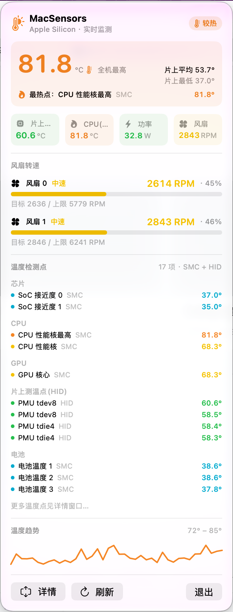

# MacSensors — Swift 原生 macOS 菜单栏硬件监控 + 桌面组件

一个**纯 Swift / SwiftUI / WidgetKit** 写的 macOS 小应用，实时显示 Apple Silicon 的
芯片温度、CPU 温度、风扇转速、系统功率，并提供 **小/中/大三种桌面组件**。

无需 sudo、无需安装任何第三方软件、无需守护进程、无需 iStat Menus。

## 功能

- **菜单栏常驻**：右上角显示实时温度（如 `57°`），文字与图标随温度变色。
  v1.1.1 起显示的是**全通道最高温**（SMC + HID 合并取最大），不再只跟 HID 通道
- **彩色分级界面**（v1.1 起）：下拉面板改用 `.menuBarExtraStyle(.window)` 自定义布局，
  不再是系统 NSMenu 的灰字。五档色阶贯穿菜单栏 / 下拉 / 详情 / 组件：
  青 `凉爽 <45°` → 绿 `正常 <62°` → 黄 `偏热 <75°` → 橙 `较热 <90°` → 红 `高温 ≥90°`，
  并带状态徽章与图标，一眼可判断冷热
- **风扇可视化**（v1.1 起）：不再只有裸 RPM，改为
  `静音 / 低速 / 中速 / 高速 / 满载` 档位 + 占额定转速百分比 + 横向仪表条 +
  目标转速与上限（读取 SMC `F0Mx/F0Mn`，读不到回落 5500 RPM）
- **更多温度检测点**（v1.1 起）：SMC 侧遍历 40+ 个温度 key（CPU 各核、GPU、SoC、
  内存控制器、电池、机身、电源管理器等，不存在的 key 自动跳过），HID 侧保留
  63 个片上测温点并读取系统自带传感器名（`tdie4` / `tdev8` / `TP3g`…）。
  实测 M1 Pro 上可列出 **17 个命名温度点**，按「芯片 / CPU / GPU / 片上测温点(HID) /
  电池 / 机身」分组展示
- **详情窗口**：四张彩色温度卡片（全机最高 / 片上(HID) / CPU(SMC) / 片上平均）+
  趋势曲线 + 全部温度点分组明细 + 风扇仪表
- **桌面组件**：
  - `.systemSmall`：全机最高温（带状态色）+ 风扇档位条 + 功率
  - `.systemMedium`：四宫格 + 风扇档位条 + 平均/最低温
  - `.systemLarge`：完整仪表盘 + 双风扇仪表 + 最热 6 个温度点
- 主 App 每 **5 秒** 采样一次并刷新所有 Widget 时间线
- 温度 / 风扇变化实时反映（趋势已实测）

## 界面预览



> 彩色五档分级、全机最高温 81.8°C 与「最热点」标注、风扇档位/百分比/仪表条、
> 17 个温度检测点按通道分组、温度趋势曲线。截图于 Apple M1 Pro / macOS 27。

### 温度读数的通道差异（v1.1.1 修正，重要）

`SMC` 与 `IOHID` 是**两套独立的传感器，数值不共享、不在同一标定体系**。实测常见
「CPU 82°C 但 HID 片上最高仅 58°C」的情况——这不是错误，而是两者测的是不同点。

| 显示项 | 数据来源 | 含义 |
|---|---|---|
| **全机最高**（菜单栏 / 状态色阶 / 趋势曲线） | 两路所有点位取最大 | 真正的最热点，并标注「热在哪、来自哪路」 |
| **片上(HID)** | HID 63 点最大值 | 片上热点分布，覆盖面广但单点值偏低 |
| **CPU(SMC)** | `SMC Tp0P` | CPU 性能核最高，通常最能反映负载 |
| **片上平均 / 最低** | HID 63 点 | 芯片整体温升 |

v1.1 及之前把 HID 最大值标成「芯片最高」，会让状态色阶跟着偏低的 HID 值走，
出现 CPU 已经很热、菜单栏仍显示绿色「正常」的误导。v1.1.1 已改为全通道聚合。

## 数据来源（两路原生通道，全部免特权）

### 1) Apple SMC 用户客户端 → 风扇转速 / 温度 / 功率 / 电压 / 电流

`Shared/SensorReader.swift` 里的 `SMCSensor`：

```
IOServiceMatching("AppleSMC")
  → IOServiceOpen(selector=1)          // 关键：必须用 selector 1
  → IOConnectCallMethod(conn,0,…)       // 握手
  → IOConnectCallStructMethod(conn, 2, in[80], 0x50, out[80])
     · key(FourCC) @0x00  · dataSize @0x1c  · command @0x2a  · 数据 @0x30
```

数值在 Darwin 27 (macOS 27) 上是 **little-endian IEEE754 float32**。
读取的 key：`FNum`(风扇数)、`F0Ac/F0Tg/F1Ac/F1Tg`(转速/目标)、
`Tp0C/Tp0P`(CPU 核心温度)、`TB0T`(电池)、`PSTR`(总功率)、
`VD0R/ID0R`(电压/电流)、`B0AV/BRSC`(电池电压/电量) 等。

> 这个调用布局是通过对 iStat Menus 7.20 的 `BBRStatisticsKit`
> `-[SMC process:size:key:]` 做 arm64 反汇编逆向得到的，并在本机
> Apple M1 Pro / Darwin 27 上实测通过（2179 个 SMC key、2 个风扇）。

### 2) IOHID EventSystem 私有 API → 63 个 PMU 片上测温点

`HIDTemperatureSensor`：dlsym 加载 `IOHIDEventSystemClientCreate` /
`SetMatching` / `CopyServices` / `IOHIDServiceClientCopyEvent` /
`IOHIDEventGetFloatValue`，匹配 AppleVendor 页 `0xff00` 的
TemperatureSensor usage `0x05`，读取 `kIOHIDEventTypeTemperature (=15)` 事件。

> Swift 里这些 CF 私有对象的**所有权**很关键：
> `client` 必须被强持有（否则出 init 作用域被 ARC 释放，后续调用在
> `IOMIGMachPortGetPort` 空指针崩溃）；`event` 对象归 service 所有，
> 只能 `takeUnretainedValue` 借用指针，绝不能让 ARC/CFRelease 释放
> （否则 `IOHIDEventSystemClientTerminationCallback` 二次释放崩溃）。
> 这两处坑都在本机实际触发并修复过。

## 工程结构

```
MacSensors/
├── project.yml                    # xcodegen 规格（两个 target + App Group）
├── MacSensors.xcodeproj/          # 已生成，可直接用 Xcode 打开
├── build.sh                       # 本机（无 Xcode）验证/打包脚本
├── Shared/
│   ├── SensorReader.swift         # SMC + HID 双通道采集 + 数据模型
│   └── SensorStore.swift          # App Group / 容器文件 / standard 三路回退存储
├── MacSensorsApp/
│   ├── MacSensorsApp.swift        # @main App、MenuBarExtra、详情窗口、曲线
│   ├── Info.plist                 # LSUIElement=true（纯菜单栏）
│   └── MacSensors.entitlements
└── MacSensorsWidget/
    ├── MacSensorsWidget.swift     # @main WidgetBundle、TimelineProvider、三种视图
    ├── Info.plist                 # NSExtensionPointIdentifier = widgetkit-extension
    └── MacSensorsWidget.entitlements
```

两个 target 都编译 `Shared/` 里的源码（pbxproj 已确认），Widget
`.appex` 通过 `dstSubfolderSpec=13` 嵌入主 App 的 `Contents/PlugIns`。

## 运行方式

### 有完整 Xcode（推荐）
```bash
open MacSensors.xcodeproj
# ⌘R 编译运行；Widget 会一同嵌入，可在通知中心「编辑小组件」添加 MacSensors
```
要求 macOS 14+（WidgetKit `.containerBackground` / MenuBarExtra）。

### 本机（只有 Command Line Tools，已验证）
```bash
./build.sh
open generated/build/MacSensors.app
```
`build.sh` 会用 `xcodegen` 生成工程、用 `swiftc` 编译两个二进制、
typecheck、并打包出可运行的 `.app`。

> 本机实测：主 App 连续运行 15 秒无崩溃，standard defaults 里确实写入了
> 367 字节快照 JSON（定时器持续采样）；采集→编码→存储→Widget 回读全链路通过。
> 数值示例：芯片 57.1°C / CPU 75.8°C / 风扇 2586·2800 RPM / 功率 22.4 W /
> HID 63 个测温点 / SMC 2179 个 key。

## 数据共享设计

主 App 非沙箱（IOKit 私有 API 在非沙箱下实测可用），Widget 是沙箱 app-extension。
为避免因「主 App 非沙箱 / Widget 沙箱」导致 `UserDefaults(suiteName:)` 落到不同容器，
`SensorStore` 做了**三路写入 + 三路回退读取**：

1. App Group `UserDefaults(suiteName: "group.com.macsensors.shared")`
2. `FileManager.containerURL(forSecurityApplicationGroupIdentifier:)` 下的 JSON 文件
3. `.standard` UserDefaults（未签名/命令行构建兜底）

## 工程审查后的结构修复（重要）

对工程做过一次独立静态审查，据此修掉了几个**运行时功能缺陷**（不是编译问题）：

1. **Widget 编译期隔离 IOKit（最关键）**
   把 `SensorSnapshot` 数据模型抽到 `Shared/SensorModels.swift`（纯数据、无 IOKit）。
   `Shared/SensorReader.swift`（含 SMC/HID 私有 API）**只由主 App target 编译**，
   Widget 的 `Sources` 阶段仅含 `MacSensorsWidget.swift` + `SensorModels.swift` + `SensorStore.swift`。
   同时把 Widget 里 `?? SensorReader.snapshot()` 的回退改为 `?? .placeholder`。
   → Widget 二进制里**根本没有** IOKit 依赖，沙箱内不可能因现场采样被拒或崩溃，
   也不再有「沙箱里读 SMC 拿到全 0」的问题。Widget 只读主 App 写好的共享数据。

2. **App Group 共享改为显式文件多路径**
   macOS 上 `UserDefaults(suiteName:)` 即使 ID 无效也返回非 nil 对象；
   「主 App 非沙箱 + Widget 沙箱」时两端 suite 会落不同 domain，主 App 写、Widget 读不到。
   `SensorStore` 改为：写 `~/Library/Application Support/MacSensors/latest-snapshot.json`（用户级固定路径）
   + App Group 容器文件 + standard defaults；读取按可靠性回退，并校验快照 10 分钟有效期。
   → 本地未签名 / 命令行构建下共享链路已实测通过（370B JSON 落盘 + 独立进程回读）。

3. **启用 ad-hoc 签名让 entitlements 真正嵌入**
   `CODE_SIGNING_ALLOWED=NO` 时 entitlements 不写入二进制，pluginkit 不认 Widget、
   App Group 也不生效。改为 `CODE_SIGN_IDENTITY="-"` + `CODE_SIGN_STYLE=Automatic`，
   embed 阶段加 `CodeSignOnCopy`（`codeSign: true`）。

4. **补齐 AppIcon asset catalog**（`Assets.xcassets/AppIcon.appiconset`，10 个尺寸 PNG 已生成），
   消除 `ASSETCATALOG_COMPILER_APPICON_NAME` 指向空资源的警告；两个 plist 补 `CFBundleDisplayName`。

> 审查里仍有两条属于**平台限制、无法靠代码消除**，见下节。

## 已知约束 / 注意事项

- 用了 **IOKit 私有 API**（`IOHIDEventSystemClient*`）和未公开的 `AppleSMCClient`
  调用布局。适合自用 / 学习；若上架 Mac App Store 会被拒，且新 macOS 版本可能变更。
- **桌面组件可见性（平台限制，需真签名）**：WidgetKit 的插件发现（pluginkit）
  要求 containing app 与 `.appex` 都被系统认可的签名、且 entitlements 被 codesign 嵌入。
  当前是 ad-hoc 签名 `"-"`，用完整 Xcode **Build & Run**（而非仅 build）通常能让
  Widget 出现在通知中心；纯 `swiftc` 手搓的 `.app`（无签名/无 `.appex` 包装）
  只能验证菜单栏 App，Widget 不会显示。
  要在另一台 Mac 稳定分发，需：真实 `DEVELOPMENT_TEAM` + "Apple Development"/"Developer ID"
  签名、Hardened Runtime、两个 App ID 在后台启用 App Groups（macOS 建议把组 ID
  改成 `<TEAMID>.group.*` 格式）。这一步需要 Apple 开发者账号，无法在本机（仅 CLT）完成。
- 发布/上架：MAS 强制主 App 也沙箱化，但私有 IOKit API 会被审核拒绝；
  **Developer ID 分发（非沙箱）是本项目的现实路径**。
- SMC key 命名与 float32 格式在 Intel Mac / 旧系统上不同；当前实现针对
  **Apple Silicon + Darwin 27**。其他机型 `SMCSensor.init?` 会返回 nil，
  HID 通道仍可用，App 优雅降级。
- Widget 时间线策略为每分钟刷新一次读取共享快照；主 App 每 5 秒写一次，
  因此组件显示的是「最近一次采样」而非秒级实时。

## 与之前命令行工具的关系

`../mac-sensors.sh` / `../mac-temp.sh` 是同一套采集逻辑的 C + bash 原型。
本工程把它**全部用 Swift 重写**并做成 GUI + Widget，可独立运行，不依赖那两个脚本。
